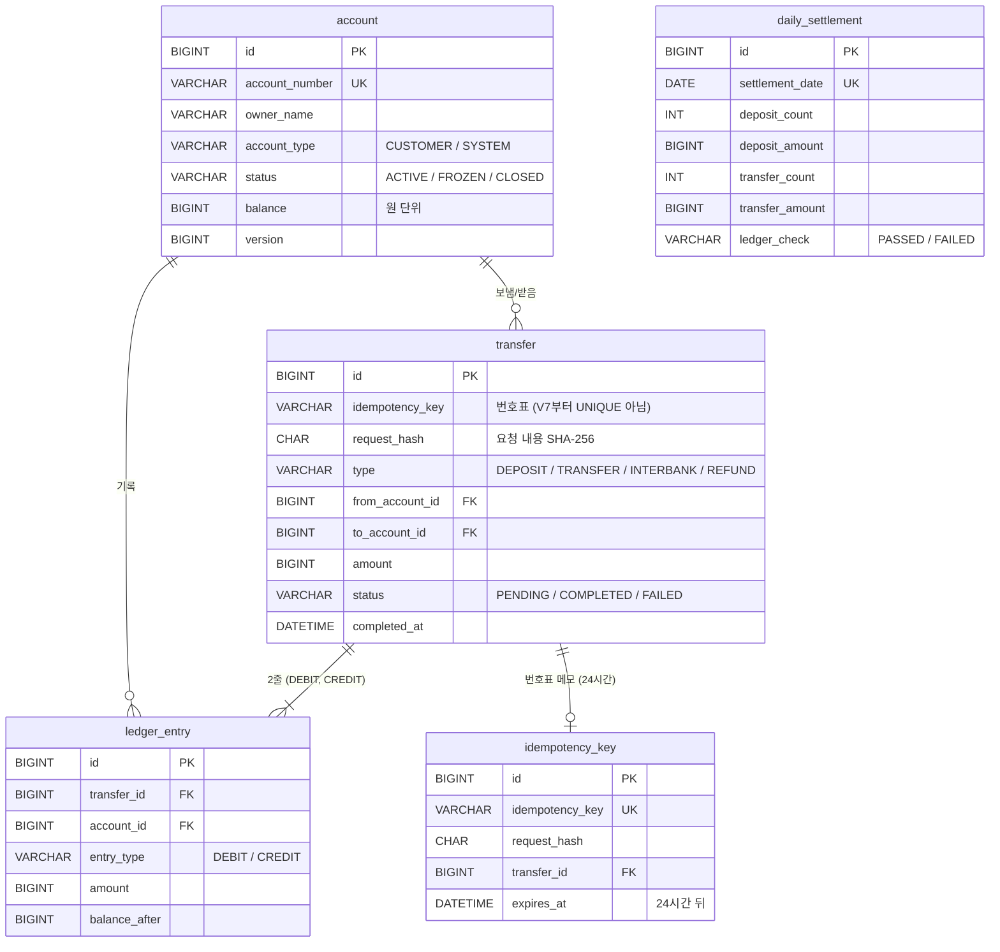
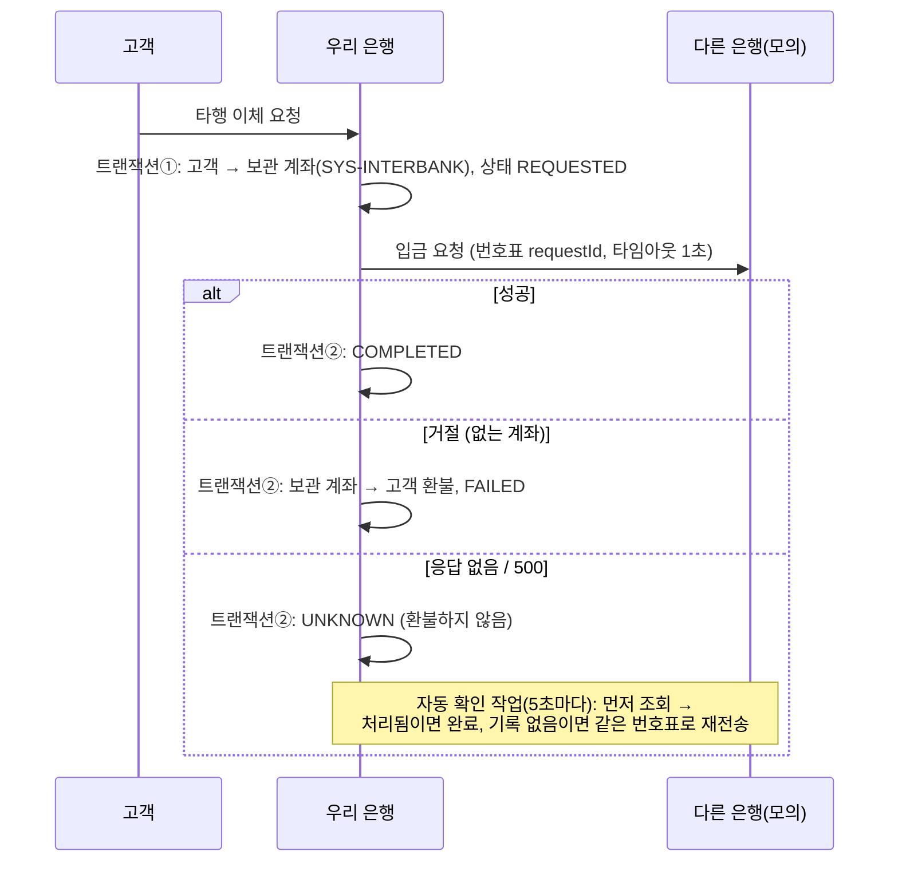

# bank_core — 계좌·이체 코어 시스템


[](https://github.com/oh3happy52-cmd/bank_core/actions/workflows/ci.yml)


동시에 이체 요청이 몰려도 **잔액이 틀리지 않는** 은행 계좌·이체 서버입니다.
문제를 먼저 **재현**하고, 해결 방법을 **숫자로 비교**해서 선택했습니다.

**배포 주소 (Swagger)**: http://3.107.98.210/swagger-ui.html
(체험용 계정 `chulsoo / chulsoo1234`, `younghee / younghee1234` → `인증 > 로그인`으로 토큰을 받아 오른쪽 위 **Authorize**에 넣으세요. 관리자 계정은 공개하지 않습니다)

## 핵심 성과

| 주제 | 결과 |
|---|---|
| 갱신 손실 재현 | 락 없이 이체 요청 100건 동시 실행 → 100건 모두 "성공" 응답, 실제 반영은 **10건** |
| 락 방식 비교 | 비관적 락 / 낙관적 락+재시도 / 원자적 UPDATE 모두 정확. 낙관적 락+재시도가 **약 2배 느림** |
| 데드락 | 잠금 순서를 계좌번호 순으로 통일 → 데드락 **50건 → 0건** |
| 멱등성 | 같은 Idempotency-Key로 입금 요청 10건 동시 실행 → 입금 **1번만** (성공 1 / 409 9) |
| 원장 검증 | 장부 없이 잔액만 500원 조작 → 해당 계좌와 전체 합계 오차 **500원 적발** |
| 쿼리 튜닝 | 100만 건 중 하루치 조회: 풀 스캔 **517ms → 5.87ms** (복합 인덱스) |
| 부하 테스트 | 같은 두 계좌에 20명 동시 이체 30초: **초당 약 125건**(인증 추가 후 약 100건), 실패 0%, 이후 원장 검사 통과 |
| 타행 이체 장애 대응 | 다른 은행 실패 30%·지연 20% 상태에서 1,000건 → 미확정 **0건**, 이중 지급 **0건**, 원장 검사 통과 |
| 인증·권한 | JWT 로그인, 본인 계좌만 조회·이체, 관리자 API 분리 (401/403 테스트 8개), 운영 관리자 비밀번호는 환경 변수로만 설정 |
| 잔액 부족·입력 방어 | 잔액 + 1원 이체 → 422, 잔액·이체 기록·원장·번호표 **변화 없음**. 타행은 다른 은행에 요청조차 안 감. 금액 상한·번호표 길이·내부 계좌 대상 차단 테스트 |
| 멱등성 키 만료 | 번호표 메모를 이체 기록과 분리해 24시간만 보관 → 재전송은 막고, 하루 지난 같은 키는 새 요청으로 처리 |
| CI / 배포 | GitHub Actions로 push마다 전체 테스트, AWS EC2 + Docker Compose로 배포 |

## 목차

- [기술 스택](#기술-스택)
- [설계](#설계)
   - [테이블](#테이블)
   - [패키지 구조](#패키지-구조)
   - [API](#api)
- [주요 문제와 해결](#주요-문제와-해결)
   - [1. 동시 이체 시 잔액이 틀어지는 문제 (갱신 손실)](#1-동시-이체-시-잔액이-틀어지는-문제-갱신-손실)
   - [2. 데드락](#2-데드락)
   - [3. 같은 요청이 두 번 처리되는 문제 (멱등성)](#3-같은-요청이-두-번-처리되는-문제-멱등성)
   - [4. 원장 정합성 검증과 일일 정산](#4-원장-정합성-검증과-일일-정산)
   - [5. 쿼리 튜닝](#5-쿼리-튜닝)
   - [6. 부하 테스트 (k6)](#6-부하-테스트-k6)
   - [7. 인증·권한 (Spring Security + JWT)](#7-인증권한-spring-security--jwt)
   - [8. 타행 이체와 장애 대응](#8-타행-이체와-장애-대응)
   - [9. CI와 배포](#9-ci와-배포)
- [트러블슈팅](#트러블슈팅)
- [실행 방법](#실행-방법)
- [한계와 개선 방향](#한계와-개선-방향)

## 기술 스택

| 구분 | 기술 |
|---|---|
| 언어 | Java 21 |
| 프레임워크 | Spring Boot 4.1, Spring Data JPA (Hibernate 7) |
| DB | MySQL 8.4 (Docker), Flyway |
| 테스트 | JUnit 5, Testcontainers (테스트마다 실제 MySQL 컨테이너 사용) |
| 인증 | Spring Security, OAuth2 Resource Server (JWT HS256), BCrypt |
| API 문서 | springdoc-openapi (Swagger UI) |
| 부하 테스트 | k6 |
| CI | GitHub Actions |
| 배포 | AWS EC2 (Ubuntu 24.04), Docker, Docker Compose |

## 설계

### 테이블



- **복식부기 원장**: 이체 1건 = 나간 쪽(DEBIT) 1줄 + 들어온 쪽(CREDIT) 1줄. 원장은 INSERT만 함
- **입금도 이체로 기록**: 시스템 계좌(SYS-CASH) → 고객 계좌. 그래서 전체 잔액 합은 항상 0
- **금액**: 원 단위 `BIGINT` (소수점 오차 없음)

### 패키지 구조

기능(도메인)별로 먼저 나누고, 그 안에서 역할별로 나눴습니다.

```
account / transfer / ledger / settlement / member / interbank / mockbank / common
  ├── api          컨트롤러 (HTTP 요청·응답)
  ├── application  서비스 (업무 흐름, 트랜잭션)
  └── domain       엔티티, 리포지토리
```

### API

Swagger UI: 배포 서버 http://3.107.98.210/swagger-ui.html (로컬은 `http://localhost:8080/swagger-ui.html`)

| 메서드 | 경로 | 설명 |
|---|---|---|
| POST | `/api/v1/auth/login` | 로그인 → JWT 발급 |
| GET | `/api/v1/accounts/{accountNumber}` | 계좌 조회 (본인 또는 관리자) |
| POST | `/api/v1/accounts/{accountNumber}/deposits` | 입금 (`Idempotency-Key` 필수) |
| POST | `/api/v1/transfers` | 이체 (보내는 계좌 주인만, `Idempotency-Key` 필수) |
| POST | `/api/v1/interbank-transfers` | 타행 이체 (`Idempotency-Key` 필수, 결과 201 완료 / 200 실패·환불 / 202 확인 중) |
| GET | `/api/v1/interbank-transfers/{id}` | 타행 이체 상태 조회 |
| GET | `/api/v1/admin/ledger/verification` | 원장 정합성 검사 (관리자) |
| POST | `/api/v1/admin/settlements?date=` | 일일 정산 수동 실행 (관리자) |

인증: `Authorization: Bearer {토큰}`. 토큰 없음·위조·만료는 401, 권한 부족은 403

에러 응답은 항상 같은 모양입니다.

```json
HTTP 422
{"code": "INSUFFICIENT_BALANCE", "message": "잔액이 부족합니다"}
```

## 주요 문제와 해결

### 1. 동시 이체 시 잔액이 틀어지는 문제 (갱신 손실)

- **재현**: 락 없이 같은 계좌에 1,000원 이체 요청 100건 동시 실행 → 100건 모두 성공 응답, 실제 반영 10건
- **원인**: 여러 요청이 같은 옛날 잔액을 읽고 각자 계산해서 덮어씀
- **비교** (같은 조건, 워밍업 1회 + 5회 측정 평균)

| 방식 | 평균 처리 시간 | 특징 |
|---|---|---|
| 비관적 락 (`SELECT ... FOR UPDATE`) | 1,016ms | 처음부터 잠그고 시작 |
| 원자적 UPDATE (`balance = balance - ?`) | 1,218ms | DB가 최신 값으로 계산 |
| 낙관적 락 (`@Version`) + 재시도 | 2,384ms | 충돌 시 재시도, 평균 765회 재시도 |

- **선택: 비관적 락**. 비관적 락과 원자적 UPDATE는 측정 범위가 겹쳐 속도 차이를 판단할 수 없었고, 비관적 락은 출금·입금 규칙을 엔티티(`Account`)에 모아 둘 수 있음
- 처음 1회 측정에서는 "원자적 UPDATE가 2배 빠름"으로 보였지만, 첫 실행 지연(JVM 워밍업) 때문이었음 → 반복 측정으로 결론 수정

자세히: [`docs/week1-lost-update.md`](docs/week1-lost-update.md), [`docs/week2-summary.md`](docs/week2-summary.md)

### 2. 데드락

- **재현**: A→B 이체 50건 + B→A 이체 50건 동시 실행, 보내는 계좌부터 잠금 → 데드락 50건
- **해결**: 항상 **계좌번호가 작은 쪽부터** 잠금 → 데드락 0건

자세히: [`docs/week2-deadlock.md`](docs/week2-deadlock.md)

### 3. 같은 요청이 두 번 처리되는 문제 (멱등성)

응답이 오는 중에 네트워크가 끊기면, 앱은 결과를 모르고 같은 요청을 다시 보냅니다.

| 상황 | 동작 |
|---|---|
| 같은 키 + 같은 내용 | 돈을 다시 옮기지 않고 **처음 결과를 그대로** 반환 (201, 같은 transferId) |
| 같은 키 + 다른 내용 | 422 `IDEMPOTENCY_KEY_REUSED` |
| 같은 키가 동시에 도착 | 1건만 처리, 나머지 409 `DUPLICATE_REQUEST` |

- 두 겹 방어: ① 돈을 옮기기 **전에** 키 조회 → ② DB `UNIQUE(idempotency_key)`가 최종 방어선
- ①만으로는 동시 도착을 못 막음 (테스트에서 10건 모두 ①을 통과, ②가 9건 차단)
- **24시간 만료**: 처음엔 키를 이체 기록(`transfer`)에 UNIQUE로 붙여서 **영원히** 막았음 → 매달 같은 키를 쓰는 요청(예: 월세)이 지난달 결과를 받고 돈이 안 나가는 문제
  - 키를 별도 테이블(`idempotency_key`, 유효기간 `expires_at`)로 분리: **이체 기록은 영구 보관, 키 메모는 24시간만**
  - 24시간 안의 같은 키 = 재전송 → 처음 결과 반환 / 지난 키 = 새 요청
  - 매시 정각 정리 작업이 지난 메모를 삭제해 테이블 크기를 "최근 24시간치"로 유지
  - 지난 메모를 지우고 같은 키로 새 메모를 넣을 때 JPA가 INSERT를 DELETE보다 먼저 보내 UNIQUE에 걸림 → 삭제 직후 `flush()`

자세히: [`docs/week3-idempotency.md`](docs/week3-idempotency.md)

### 4. 원장 정합성 검증과 일일 정산

- SQL 3개로 검사: ① 계좌마다 잔액 = 장부 합계 ② 전체 잔액 합계 = 0 ③ 이체마다 장부 2줄, DEBIT = CREDIT
- 3개 SQL을 읽기 전용 트랜잭션 하나로 실행 → 같은 시점의 데이터를 검사
- 일일 정산: 매일 00:05(한국 시간)에 어제 거래를 종류별로 합계 + 원장 검사 결과 저장. 같은 날짜는 여러 번 실행해도 한 줄만 남음
- 오늘 날짜 정산은 거절: 안 끝난 날을 저장하면 이후 거래가 빠진 채 고정되기 때문

자세히: [`docs/week3-summary.md`](docs/week3-summary.md)

### 5. 쿼리 튜닝

정산 SQL(`status = 'COMPLETED' AND completed_at` 하루 범위)을 거래 100만 건에서 측정했습니다.

| 항목 | 인덱스 없음 | `(status, completed_at)` 인덱스 |
|---|---|---|
| 실행 계획 `type` | `ALL` (풀 스캔) | `range` (범위 스캔) |
| 읽는 줄 수 (예상) | 989,254 | 2,647 |
| 실행 시간 | 517ms | **5.87ms** |

- 같다(=) 조건 컬럼을 앞에, 범위 조건 컬럼을 뒤에 둔 복합 인덱스
- 실험 스크립트: [`scripts/tuning/`](scripts/tuning/)

### 6. 부하 테스트 (k6)

같은 두 계좌 사이 이체를 가상 사용자 20명이 30초 동안 반복 (같은 행 잠금을 기다리는 최악의 경우)

| 항목 | 결과 |
|---|---|
| 처리량 | 초당 약 125건 (총 3,827건) |
| 응답 시간 | 평균 157ms, p95 213ms |
| 실패율 | 0% |
| 테스트 후 원장 검사 | `consistent: true` |

- 같은 계좌를 잠그는 요청은 한 줄로 처리되므로, 이 수치는 **계좌 하나에 요청이 몰릴 때의 한계**
- 스크립트: [`scripts/k6/transfer-load.js`](scripts/k6/transfer-load.js)

### 7. 인증·권한 (Spring Security + JWT)

- 로그인하면 서버가 비밀 키로 **서명한 JWT**(회원 번호, 역할, 만료 1시간)를 발급. 이후 요청은 토큰 서명만 검사 (세션 없음, STATELESS)
- 비밀번호는 BCrypt 해시로만 저장
- 계좌 조회는 본인 또는 관리자, 이체는 **보내는 계좌 주인만** (관리자도 남의 돈은 못 옮김), `/api/v1/admin/**`는 관리자만
- 주인 확인은 계좌 엔티티를 미리 불러오지 않고 `exists` 쿼리로만 함 → 뒤에서 비관적 락으로 읽을 때 옛날 잔액이 섞이지 않게
- MockMvc 테스트 8개: 본인 200, 남의 계좌 403, 토큰 없음 401, 서명 위조 토큰 401, USER가 관리자 API 403 등

**공개 서버를 위한 방어** (누구나 Swagger로 시도할 수 있으므로)

| 위험 | 방어 | 테스트 |
|---|---|---|
| 관리자 비밀번호 노출 | 개발용 `admin1234`는 운영에서 무효. `prod` 프로필에서 서버가 켜질 때 환경 변수 `ADMIN_PASSWORD`(12자 이상, 없으면 서버가 안 켜짐)로 바꿈 | `AdminPasswordInitializerTest` |
| 잔액 부족 | `Account.debit()`에서 422. 트랜잭션 전체 롤백 → 이체 기록·원장·번호표 메모 0건. 타행 이체는 다른 은행에 보내기 **전에** 막힘 | `TransferInsufficientBalanceTest` |
| 남의 계좌번호 알아내기 | 일반 회원은 "남의 계좌"와 "없는 계좌" 모두 403 (404/403 차이로 존재 여부를 알 수 없음) | `InputDefenseTest` |
| 아이디 존재 여부 알아내기 | 없는 아이디도 BCrypt 비교를 한 번 해서 응답 시간과 오류를 같게 함 | `InputDefenseTest` |
| 은행 내부 계좌 조작 | 고객·관리자 모두 SYS-CASH·SYS-INTERBANK로 입금·이체 불가 (422). 보관 계좌가 틀어지면 타행 정산이 깨지기 때문 | `InputDefenseTest` |
| 터무니없는 입력으로 500 | 금액 1회 최대 10억 원, 계좌번호·은행 코드·번호표 길이를 DB 칸 길이에 맞춰 400으로 막음 | `InputDefenseTest` |
| 컨테이너 탈취 | 앱 컨테이너는 root가 아닌 일반 사용자(`app`)로 실행 | - |

### 8. 타행 이체와 장애 대응

다른 은행 서버는 느리거나 죽을 수 있고, **응답이 없으면 돈이 갔는지 알 수 없습니다.**



- **외부 호출은 트랜잭션 밖에서**: 느린 응답을 기다리는 동안 계좌 잠금·DB 연결을 붙잡지 않음
- **UNKNOWN이면 바로 환불하지 않음**: 실제로는 입금됐을 수 있어서 환불하면 이중 지급. "확실히 거절"일 때만 환불(보상 트랜잭션)
- **같은 번호표 재전송**: 다른 은행도 번호표로 중복을 막으므로 다시 보내도 한 번만 처리
- 결과 반영은 행 잠금 + 이미 끝난 건 건너뛰기 → 응답 처리와 자동 확인이 동시에 와도 한 번만 반영

**장애 실험** (`InterbankChaosTest`, 실제 HTTP, 타임아웃 300ms / 지연 600ms)

| 항목 | 결과 |
|---|---|
| 보낸 건수 | 1,000건 (없는 계좌 50건 포함), 실패 30% · 지연 20% 주입 |
| 첫 응답 직후 | 완료 511 / **모름 459** / 실패 30 (실행마다 확률적으로 달라짐) |
| 자동 확인 1회 후 | 완료 950 / 실패(환불) 50 / **모름 0** |
| 다른 은행 입금 vs 우리 쪽 완료 | 950건 950,000원 = 950건 950,000원 (**이중 지급 0**) |
| 환불했는데 입금된 건 | **0** |
| 원장 검사 | 통과 |

### 9. CI와 배포

- **CI**: main에 push할 때마다 GitHub Actions가 Testcontainers로 전체 테스트 실행 (README 맨 위 배지)
- **배포**: AWS EC2 한 대에 Docker Compose로 앱 + MySQL 실행
  - `Dockerfile` 2단계 빌드: JDK로 빌드 → JRE와 jar만 담아 실행 이미지를 작게
  - MySQL은 외부에 포트를 열지 않고, 앱만 80번으로 공개
  - DB 비밀번호·JWT 비밀 키는 서버의 `.env`(Git 제외)에서 환경 변수로 주입, 운영 프로필(`prod`)에서는 SQL 로그 끔
  - 보안 그룹: SSH는 내 IP만, HTTP는 전체 허용
  - 모의 타행의 실험용 API(고장 스위치, 초기화)는 관리자만 호출 가능

## 트러블슈팅

| 문제 | 원인 | 해결 |
|---|---|---|
| "원자적 UPDATE가 2배 빠름" 오판 | 워밍업 없는 1회 측정 | 워밍업 + 5회 반복, 실행 순서 교대 |
| 에러 응답 추가 후에도 500 | 일부 클래스가 예전 예외를 던짐 | 서버 로그의 클래스·줄 번호로 찾아 교체 |
| 오늘 날짜 정산 시 틀린 기록이 고정될 뻔함 | 안 끝난 날 정산 + 멱등성 | 어제 이전만 허용 |
| Flyway가 V4를 무시 | 파일명이 소문자 `v4` | 대문자로 변경. Mac은 대소문자 변경을 Git이 못 알아채서 `git mv -f`로 반영 |
| 테스트 간 DB 오염 | 실험 코드가 원장 없이 잔액 변경 | 정합성·정산 테스트 전후 DB 초기화 |
| CI에서만 정산 테스트 실패 (저장된 줄 0) | GitHub 서버는 UTC. 시간대를 `@PostConstruct`에서 바꿨는데, 그 전에 DB 연결이 UTC로 만들어져 날짜가 하루 어긋남 | JVM 시작 옵션(`-Duser.timezone=Asia/Seoul`)과 `main()` 첫 줄에서 고정. 로컬에서 `TZ=UTC`로 재현 후 수정 |
| `RestClient.Builder` 빈을 못 찾음 | Spring Boot 4에서 자동 설정이 모듈로 분리됨 | `RestClient.builder()`를 직접 생성해 타임아웃 설정 |
| 같은 키 재사용 시 UNIQUE 위반 | JPA가 INSERT를 DELETE보다 먼저 실행 | 지난 메모 삭제 직후 `flush()` |
| 관리자 비밀번호가 README·Swagger에 공개됨 (리뷰에서 지적) | 개발용 계정을 그대로 체험용으로 안내 | 문서에서 삭제, 운영은 환경 변수로 비밀번호 설정 + 공개 서버 입력 방어 점검 |
| 배포 명령이 Mac에서 실행됨 | `exit`과 `ssh`를 한 번에 붙여넣어, 접속이 끊기며 뒤 명령이 Mac에서 실행 | 운영용 compose에 프로젝트 이름(`bank-core-prod`)을 따로 지정해 개발용 컨테이너와 겹치지 않게 함 |

## 실행 방법

필요: Java 21, Docker

```bash
# 1. MySQL 실행 (포트 3307)
docker compose up -d

# 2. 서버 실행 → http://localhost:8080/swagger-ui.html
./gradlew bootRun

# 3. 테스트 (Testcontainers가 MySQL 컨테이너를 따로 띄움, Docker 필요)
./gradlew test

# 4. 부하 테스트 (서버 실행 중, k6 설치 필요)
k6 run scripts/k6/transfer-load.js
```

**서버(EC2, Ubuntu) 배포**

```bash
git clone https://github.com/oh3happy52-cmd/bank_core.git && cd bank_core
bash scripts/deploy/setup-server.sh            # 스왑 2GB + Docker 설치 (다시 접속 필요)
cp .env.example .env                           # DB·JWT·관리자 비밀번호를 무작위 값으로 바꿈 (openssl rand)
docker compose -f docker-compose.prod.yml up -d --build
```

## 한계와 개선 방향

- 모든 입금이 시스템 계좌(SYS-CASH) 한 행을 잠금 → 입금이 매우 많으면 대기가 몰림 (시스템 계좌를 여러 개로 나누는 방법 고려)
- 서버를 여러 대 띄우면 각 서버의 정산 스케줄러가 모두 실행됨 (결과는 UNIQUE로 한 줄이지만, 분산 락으로 한 서버만 실행하게 개선 가능)
- 정리 작업이 만료 메모를 DELETE 한 번으로 지움 → 수백만 건이면 1,000건씩 나눠 지우도록 개선 필요
- 배포 서버는 HTTPS 없음 (도메인 + 인증서 필요), 서버 1대·DB 같은 서버라 장애에 약함
- 체험용 일반 계정 2개는 공개 (관리자는 비공개). 실제 서비스라면 회원가입 필요
- 로그인 시도 횟수 제한이 없음 (실서비스라면 계정 잠금·요청 속도 제한 필요)
- 정산은 입금·이체만 합계 (타행·환불 종류는 별도 항목으로 확장 필요)
- 타행 이체가 계속 UNKNOWN이면 시도 횟수 경고 로그만 남김 (실무라면 운영자 알림·수동 처리 화면 필요)