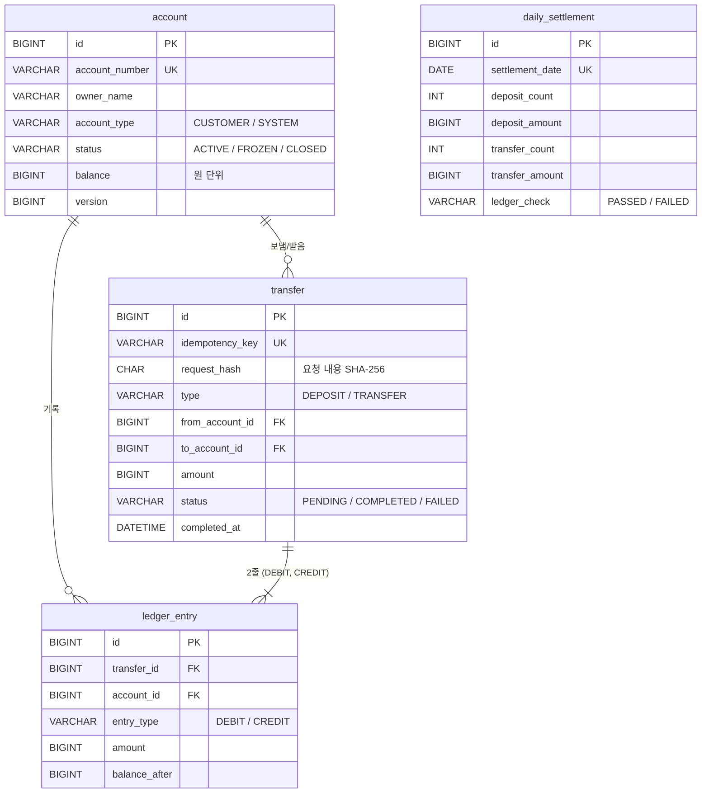

# bank_core — 계좌·이체 코어 시스템

동시에 이체 요청이 몰려도 **잔액이 틀리지 않는** 은행 계좌·이체 서버입니다.
문제를 먼저 **재현**하고, 해결 방법을 **숫자로 비교**해서 선택했습니다.

## 핵심 성과

| 주제 | 결과 |
|---|---|
| 갱신 손실 재현 | 락 없이 이체 요청 100건 동시 실행 → 100건 모두 "성공" 응답, 실제 반영은 **10건** |
| 락 방식 비교 | 비관적 락 / 낙관적 락+재시도 / 원자적 UPDATE 모두 정확. 낙관적 락+재시도가 **약 2배 느림** |
| 데드락 | 잠금 순서를 계좌번호 순으로 통일 → 데드락 **50건 → 0건** |
| 멱등성 | 같은 Idempotency-Key로 입금 요청 10건 동시 실행 → 입금 **1번만** (성공 1 / 409 9) |
| 원장 검증 | 장부 없이 잔액만 500원 조작 → 해당 계좌와 전체 합계 오차 **500원 적발** |
| 쿼리 튜닝 | 100만 건 중 하루치 조회: 풀 스캔 **517ms → 5.87ms** (복합 인덱스) |
| 부하 테스트 | 같은 두 계좌에 20명 동시 이체 30초: **초당 약 125건**, p95 213ms, 실패 0%, 이후 원장 검사 통과 |

## 기술 스택

| 구분 | 기술 |
|---|---|
| 언어 | Java 21 |
| 프레임워크 | Spring Boot 4.1, Spring Data JPA (Hibernate 7) |
| DB | MySQL 8.4 (Docker), Flyway |
| 테스트 | JUnit 5, Testcontainers (테스트마다 실제 MySQL 컨테이너 사용) |
| API 문서 | springdoc-openapi (Swagger UI) |
| 부하 테스트 | k6 |

## 설계

### 테이블



- **복식부기 원장**: 이체 1건 = 나간 쪽(DEBIT) 1줄 + 들어온 쪽(CREDIT) 1줄. 원장은 INSERT만 함
- **입금도 이체로 기록**: 시스템 계좌(SYS-CASH) → 고객 계좌. 그래서 전체 잔액 합은 항상 0
- **금액**: 원 단위 `BIGINT` (소수점 오차 없음)

### 패키지 구조

기능(도메인)별로 먼저 나누고, 그 안에서 역할별로 나눴습니다.

```
account / transfer / ledger / settlement / common
  ├── api          컨트롤러 (HTTP 요청·응답)
  ├── application  서비스 (업무 흐름, 트랜잭션)
  └── domain       엔티티, 리포지토리
```

### API

Swagger UI: 서버 실행 후 `http://localhost:8080/swagger-ui/index.html`

| 메서드 | 경로 | 설명 |
|---|---|---|
| GET | `/api/v1/accounts/{accountNumber}` | 계좌 조회 |
| POST | `/api/v1/accounts/{accountNumber}/deposits` | 입금 (`Idempotency-Key` 필수) |
| POST | `/api/v1/transfers` | 이체 (`Idempotency-Key` 필수) |
| GET | `/api/v1/admin/ledger/verification` | 원장 정합성 검사 (운영자용) |
| POST | `/api/v1/admin/settlements?date=` | 일일 정산 수동 실행 (운영자용) |

에러 응답은 항상 같은 모양입니다.

```json
HTTP 422
{"code": "INSUFFICIENT_BALANCE", "message": "잔액이 부족합니다"}
```

## 주요 문제와 해결

### 1. 동시 이체 시 잔액이 틀어지는 문제 (갱신 손실)

- **재현**: 락 없이 같은 계좌에 1,000원 이체 요청 100건 동시 실행 → 100건 모두 성공 응답, 실제 반영 10건
- **원인**: 여러 요청이 같은 옛날 잔액을 읽고 각자 계산해서 덮어씀
- **비교** (같은 조건, 워밍업 1회 + 5회 측정 평균)

| 방식 | 평균 처리 시간 | 특징 |
|---|---|---|
| 비관적 락 (`SELECT ... FOR UPDATE`) | 1,016ms | 처음부터 잠그고 시작 |
| 원자적 UPDATE (`balance = balance - ?`) | 1,218ms | DB가 최신 값으로 계산 |
| 낙관적 락 (`@Version`) + 재시도 | 2,384ms | 충돌 시 재시도, 평균 765회 재시도 |

- **선택: 비관적 락**. 비관적 락과 원자적 UPDATE는 측정 범위가 겹쳐 속도 차이를 판단할 수 없었고, 비관적 락은 출금·입금 규칙을 엔티티(`Account`)에 모아 둘 수 있음
- 처음 1회 측정에서는 "원자적 UPDATE가 2배 빠름"으로 보였지만, 첫 실행 지연(JVM 워밍업) 때문이었음 → 반복 측정으로 결론 수정

자세히: [`docs/week1-lost-update.md`](docs/week1-lost-update.md), [`docs/week2-summary.md`](docs/week2-summary.md)

### 2. 데드락

- **재현**: A→B 이체 50건 + B→A 이체 50건 동시 실행, 보내는 계좌부터 잠금 → 데드락 50건
- **해결**: 항상 **계좌번호가 작은 쪽부터** 잠금 → 데드락 0건

자세히: [`docs/week2-deadlock.md`](docs/week2-deadlock.md)

### 3. 같은 요청이 두 번 처리되는 문제 (멱등성)

응답이 오는 중에 네트워크가 끊기면, 앱은 결과를 모르고 같은 요청을 다시 보냅니다.

| 상황 | 동작 |
|---|---|
| 같은 키 + 같은 내용 | 돈을 다시 옮기지 않고 **처음 결과를 그대로** 반환 (201, 같은 transferId) |
| 같은 키 + 다른 내용 | 422 `IDEMPOTENCY_KEY_REUSED` |
| 같은 키가 동시에 도착 | 1건만 처리, 나머지 409 `DUPLICATE_REQUEST` |

- 두 겹 방어: ① 돈을 옮기기 **전에** 키 조회 → ② DB `UNIQUE(idempotency_key)`가 최종 방어선
- ①만으로는 동시 도착을 못 막음 (테스트에서 10건 모두 ①을 통과, ②가 9건 차단)

자세히: [`docs/week3-idempotency.md`](docs/week3-idempotency.md)

### 4. 원장 정합성 검증과 일일 정산

- SQL 3개로 검사: ① 계좌마다 잔액 = 장부 합계 ② 전체 잔액 합계 = 0 ③ 이체마다 장부 2줄, DEBIT = CREDIT
- 3개 SQL을 읽기 전용 트랜잭션 하나로 실행 → 같은 시점의 데이터를 검사
- 일일 정산: 매일 00:05(한국 시간)에 어제 거래를 종류별로 합계 + 원장 검사 결과 저장. 같은 날짜는 여러 번 실행해도 한 줄만 남음
- 오늘 날짜 정산은 거절: 안 끝난 날을 저장하면 이후 거래가 빠진 채 고정되기 때문

자세히: [`docs/week3-summary.md`](docs/week3-summary.md)

### 5. 쿼리 튜닝

정산 SQL(`status = 'COMPLETED' AND completed_at` 하루 범위)을 거래 100만 건에서 측정했습니다.

| 항목 | 인덱스 없음 | `(status, completed_at)` 인덱스 |
|---|---|---|
| 실행 계획 `type` | `ALL` (풀 스캔) | `range` (범위 스캔) |
| 읽는 줄 수 (예상) | 989,254 | 2,647 |
| 실행 시간 | 517ms | **5.87ms** |

- 같다(=) 조건 컬럼을 앞에, 범위 조건 컬럼을 뒤에 둔 복합 인덱스
- 실험 스크립트: [`scripts/tuning/`](scripts/tuning/)

### 6. 부하 테스트 (k6)

같은 두 계좌 사이 이체를 가상 사용자 20명이 30초 동안 반복 (같은 행 잠금을 기다리는 최악의 경우)

| 항목 | 결과 |
|---|---|
| 처리량 | 초당 약 125건 (총 3,827건) |
| 응답 시간 | 평균 157ms, p95 213ms |
| 실패율 | 0% |
| 테스트 후 원장 검사 | `consistent: true` |

- 같은 계좌를 잠그는 요청은 한 줄로 처리되므로, 이 수치는 **계좌 하나에 요청이 몰릴 때의 한계**
- 스크립트: [`scripts/k6/transfer-load.js`](scripts/k6/transfer-load.js)

## 트러블슈팅

| 문제 | 원인 | 해결 |
|---|---|---|
| "원자적 UPDATE가 2배 빠름" 오판 | 워밍업 없는 1회 측정 | 워밍업 + 5회 반복, 실행 순서 교대 |
| 에러 응답 추가 후에도 500 | 일부 클래스가 예전 예외를 던짐 | 서버 로그의 클래스·줄 번호로 찾아 교체 |
| 오늘 날짜 정산 시 틀린 기록이 고정될 뻔함 | 안 끝난 날 정산 + 멱등성 | 어제 이전만 허용 |
| Flyway가 V4를 무시 | 파일명이 소문자 `v4` | 대문자로 변경. Mac은 대소문자 변경을 Git이 못 알아채서 `git mv -f`로 반영 |
| 테스트 간 DB 오염 | 실험 코드가 원장 없이 잔액 변경 | 정합성·정산 테스트 전후 DB 초기화 |

## 실행 방법

필요: Java 21, Docker

```bash
# 1. MySQL 실행 (포트 3307)
docker compose up -d

# 2. 서버 실행 → http://localhost:8080/swagger-ui/index.html
./gradlew bootRun

# 3. 테스트 (Testcontainers가 MySQL 컨테이너를 따로 띄움, Docker 필요)
./gradlew test

# 4. 부하 테스트 (서버 실행 중, k6 설치 필요)
k6 run scripts/k6/transfer-load.js
```

## 한계와 개선 방향

- 모든 입금이 시스템 계좌(SYS-CASH) 한 행을 잠금 → 입금이 매우 많으면 대기가 몰림 (시스템 계좌를 여러 개로 나누는 방법 고려)
- 서버를 여러 대 띄우면 각 서버의 정산 스케줄러가 모두 실행됨 (결과는 UNIQUE로 한 줄이지만, 분산 락으로 한 서버만 실행하게 개선 가능)
- 멱등성 키 보관 기간 제한(예: 24시간 후 만료) 미구현
- 인증·권한 없음 (운영자용 API도 누구나 호출 가능)